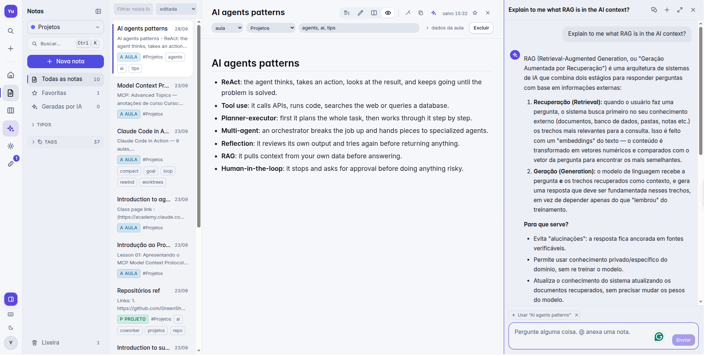
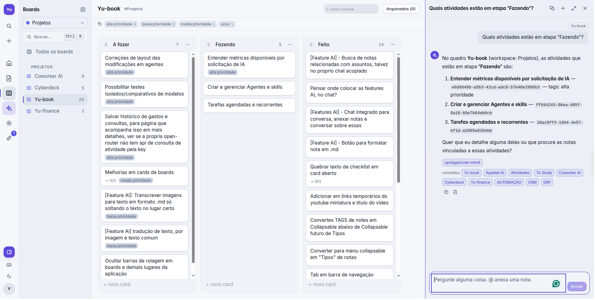
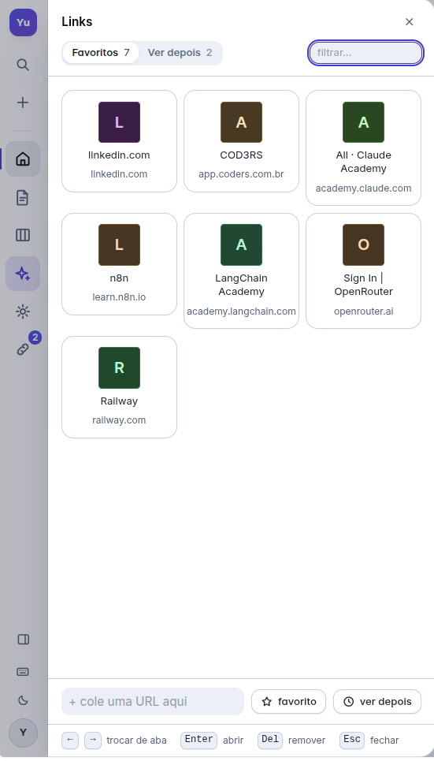
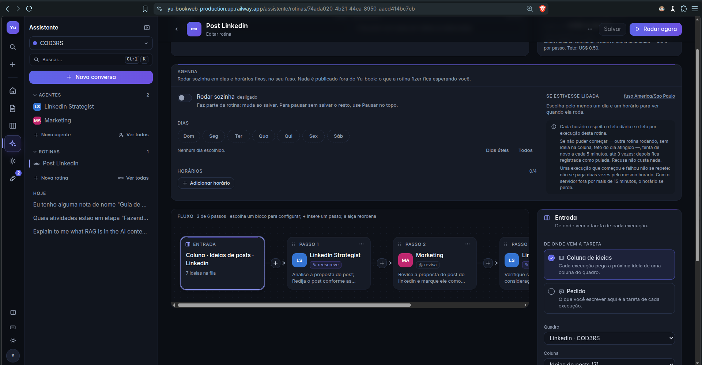
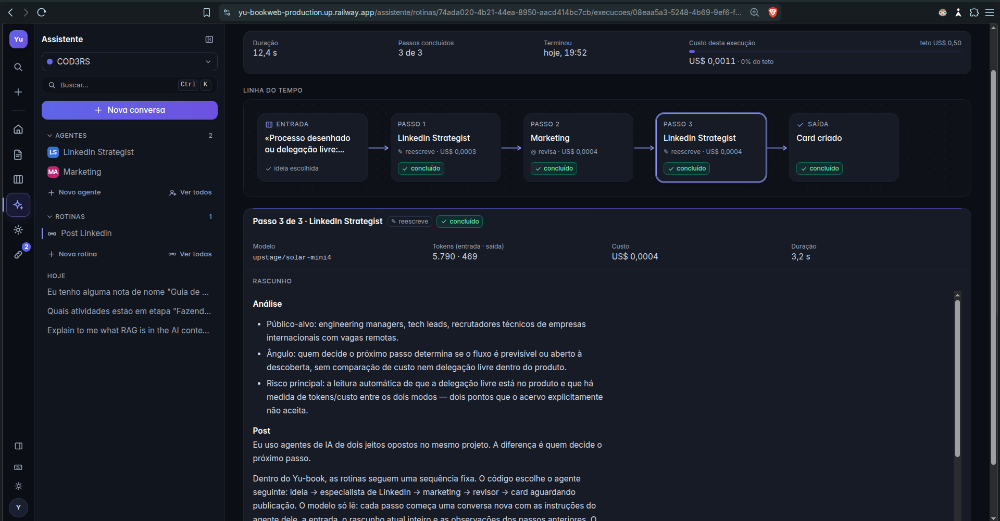
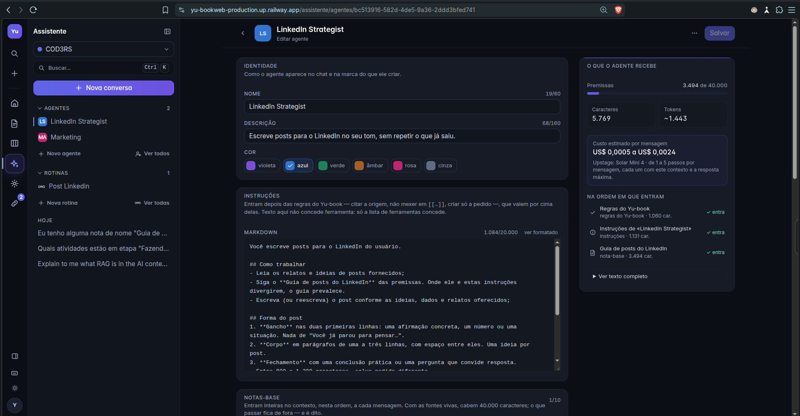
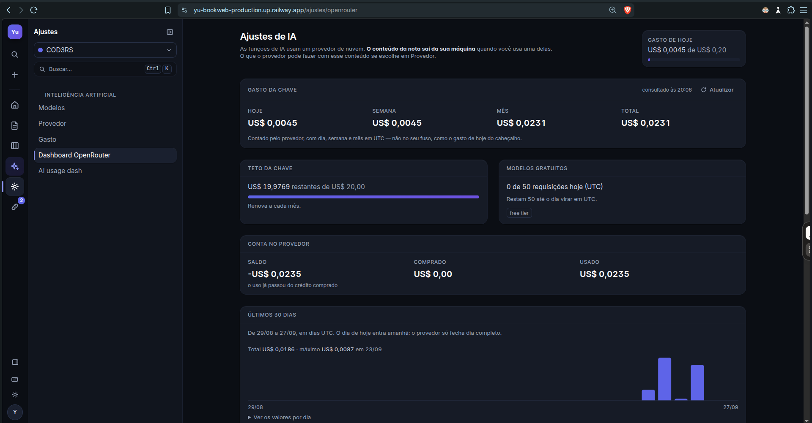
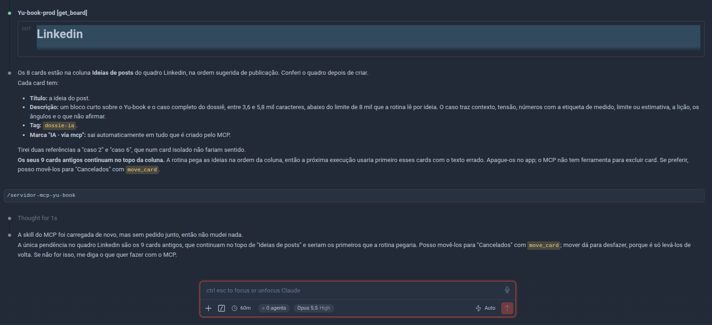
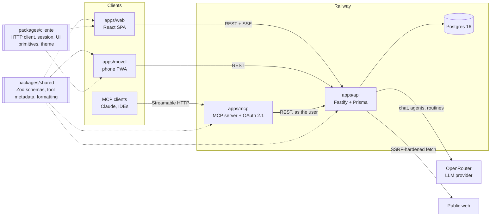

# Yu-book

**A personal second brain with an AI assistant that works on top of your own notes.**

Notes, a kanban board per workspace, a read-later link drawer and a dashboard that answers one
question: *what needs me now?* On top of that, an assistant that reads your knowledge base, a team
of specialist agents you configure yourself, and routines that chain those agents into a fixed
pipeline, on demand or on a schedule. It also works the other way around: an MCP server lets
external AI clients (Claude, IDEs) read and write the same knowledge base, with OAuth.

Single-user by design, running in production on Railway. Built solo, with Claude Code and a set
of project-specific agents and skills that live in this repository.



---

## Contents

- [Features](#features)
- [Architecture](#architecture)
- [Engineering highlights](#engineering-highlights)
- [How it was built](#how-it-was-built)
- [Tech stack](#tech-stack)
- [Getting started](#getting-started)
- [Deploying to Railway](#deploying-to-railway)
- [Project status and known limitations](#project-status-and-known-limitations)

---

## Features

### Knowledge base

- **Notes of every kind in one entity:** class notes, projects, study tracks, work and free notes,
  with per-type fields stored as JSONB, so one search crosses every context.
- **Live Markdown editor** (CodeMirror 6): the markup disappears from what you have already written
  and comes back on the cursor line. Split, source and reading modes are still there.
- **`[[wikilinks]]` with backlinks.** Renaming a note rewrites every link that points to it, and a
  link to a missing title creates the note on click.
- **Full-text search in Portuguese:** accent-insensitive, stemmed (`autenticar` finds
  `autenticação`), with a trigram fallback that tolerates typos. `Ctrl+K` searches notes and cards
  from anywhere, with inline filters (`tipo:aula`, `tag:jwt`, `#workspace`).
- **Autosave** 800 ms after you stop typing, and a 30-day trash that restores tags and links intact.

### Kanban

- Boards per workspace, cards with Markdown description, due date, priority, checklist, tags and an
  optional link to a note.
- **Drag with the mouse or with the keyboard** (`Space` to pick up, arrows to move), announced to
  screen readers. Moves are optimistic and roll back if the API refuses.
- Optional WIP limit per column, which flags the column instead of blocking.
- **Mark a card as done without moving it**: it stays in its column, dimmed, and leaves the
  dashboard's deadlines.
- **Attach images and files** (PDF, text, Office, zip; up to 25 MB) by picking or dropping them on
  the card. They live in an optional S3 bucket and are read through short-lived signed URLs.



### Link drawer

- Drag a link from any other window and drop it anywhere in the app to save it as a favorite or to
  the read-later queue.
- Real page titles, fetched by the server through an SSRF-hardened client. YouTube videos get title
  and thumbnail, and the duration if an API key is set.
- Nothing expires on its own: the queue shows how long each item has been waiting.



### Agenda, tasks and the phone app

- **An agenda and a to-do list of their own:** timed and all-day events, and tasks with or without
  a date, each optionally linked to a board as its project. Days and times are always yours: the
  server resolves them in your time zone, never in the device's.
- **Weekly recurring events:** pick the days and an optional end date, and the series keeps its
  wall-clock time across daylight-saving changes. Editing or deleting one occurrence asks how far
  it should reach: just this one, this and the following ones, or the whole series.
- **Recurring tasks, for habits:** "send a job application every weekday" is one series, and each
  day is a real task you tick off on its own. The list shows only today's, and a missed day never
  piles up as overdue. A recurring event can become a recurring task in one step.
- **A phone app**, an installable PWA separate from the desktop app: the day at a glance, a monthly
  calendar, tasks grouped by urgency, projects, and one sheet to create or edit an event or a task
  from any screen. The same sheet turns an event into a task, or a task into an event.
- **The assistant on the phone**, with the same chat and agents as on the web and **voice
  dictation**: "book a meeting with Ana tomorrow at 3 pm", said into the phone, becomes an event you
  can open, edit or undo. "English class Monday, Wednesday and Friday from 8 to 9" becomes one
  recurring event, not one per week. The assistant and the MCP server can read the agenda, book
  events, add tasks and complete them; through the MCP server the agenda can also be edited,
  converted and cleaned up.
- **Today on the desktop home page:** overdue tasks and today's events and tasks, with one-click
  completion. It is re-read when you come back to the tab, so what you did on the phone is already
  there.


### AI assistant

- **Chat that reads your knowledge base.** The model calls tools (search notes, open a note, list
  and open boards, read the dashboard and the agenda) in a loop of up to five steps per message,
  answers with streaming and cites every source it used. `@` attaches a note, card or board.
- **Creates when you ask, and only then:** it can create cards, notes, events and tasks ("book
  the dentist tomorrow at 3 pm"), and mark a card or a task as done, but it cannot move, delete or
  edit. Everything it creates carries an AI-generated mark with the model and the conversation it
  came from, plus an undo; a card or task it completes says so too. You can also dictate.
- **Specialist agents:** each agent has its own instructions, base notes from your knowledge base,
  live sources (a board column read fresh on every message), its own model and its own tool set.
  The editor previews exactly what the model will receive, and at what cost.
- **Routines:** agents chained in a fixed sequence (up to six steps) that start from an idea in a
  column or from a written request, and end as a new card or a new note. Steps only read; the code
  writes the output at the end. Runs are executed on the server, detached from the browser tab,
  with a live view of each step, its tokens and its cost.
- **Scheduling:** routines run on their own at the times you set, in your time zone.
- **Web research, opt-in per agent:** web search through the provider, and an "open page" tool
  behind the same SSRF defenses as the link drawer.
- **Format note:** one click reorganizes a note's Markdown, with an 8-second undo. The response is
  checked in code so that `[[wikilinks]]` can never change.







### Cost control

- **Daily spend cap** (US$ 0.20 by default), checked before every call to the provider and again
  at every step of the tool loop; routines also have a cap per run.
- **Model catalog** with price filters, quality indexes and per-task model choice, arranged by
  drag and drop.
- **Two usage dashboards, never summed:** what the provider reports about the key and the account,
  and what Yu-book itself recorded, per day in your time zone, by model, task and cost source.



### MCP server

`apps/mcp` exposes the knowledge base to any MCP client: 21 tools (6 read, 15 write), 6 resources
and 2 prompts. It runs over **stdio** on your machine or over **Streamable HTTP** as a hosted
service, where it is its own **OAuth 2.1** authorization server and every request acts as whoever
presented the token. Writing is locked behind two independent layers. Details in
[apps/mcp/README.md](apps/mcp/README.md).



---

## Architecture



| Package | Stack | Role |
|---|---|---|
| `apps/api` | Fastify 5, Prisma 6, Postgres 16 | REST API, AI orchestration, background runs and scheduler |
| `apps/web` | React 19, Vite 6, Tailwind v4, TanStack Query | Desktop-only SPA, with no UI or icon library |
| `apps/movel` | React 19, Vite 6, Tailwind v4, TanStack Query | Phone app, an installable PWA |
| `apps/mcp` | Official MCP TypeScript SDK | MCP server, a client of the API, never of the database |
| `packages/shared` | Zod 3 | Single source of truth for the contract the other packages share |
| `packages/cliente` | React 19, TypeScript source (no build step) | What both front ends share: HTTP client, session, UI primitives, icons and theme tokens |

A note on naming: the **domain is written in Portuguese** (`criar`, `mover`, `renumerarCards`) and
the **API boundary in English** (`title`, `contentMd`, `dueDate`). Both live in the same function
on purpose.

---

## Engineering highlights

- **One contract, three consumers.** Validation schemas, error codes and the metadata of the
  knowledge-base tools are defined once in `packages/shared`. The in-app chat and the MCP server
  offer the same tools from the same definition.
- **The MCP server is a client of its own API.** It inherits user scoping, ownership checks and
  stable error codes instead of reimplementing them against the database.
- **Ownership by chain.** Cards and columns have no `user_id`; ownership is resolved in the query
  through card → column → board → owner. Someone else's id returns 404, never 403.
- **Auth:** 15-minute JWT access token kept in memory, opaque refresh token in an `httpOnly`
  cookie, stored hashed, rotated on every use, with reuse detection. argon2id, constant-time login,
  rate limiting.
- **Outbound requests to third-party URLs** go through a single hardened client: public IPs only
  (cloud metadata and CGNAT included in the deny list), the connection pinned to the IP that was
  checked (no DNS rebinding), redirects revalidated on every hop, time and size budgets enforced
  after decompression.
- **A spend cap that doesn't lie.** Money is stored as integer micro-dollars. The "day" is the
  user's day, recorded at call time instead of computed later. Calls without a reported cost are
  counted and shown instead of silently counting as zero.
- **AI provenance written only by the server.** No request body can claim to be the assistant, and
  the mark never disappears, not even after editing: it turns into "revised".
- **Background runs that survive overlapping deploys.** Two API instances coexist during a Railway
  deploy, so the engine decides through the database (heartbeats, conditional writes, a partial
  unique index), never through process memory. A run that started is never retried, because a
  retry costs money again.
- **Tests against real infrastructure:** 647 integration tests boot the whole Fastify app against a
  real Postgres; 99 more cover the MCP server.

---

## How it was built

Yu-book was built by one developer in about six weeks (August–September 2026), working with
[Claude Code](https://claude.com/claude-code). The repository carries the setup that made that
work:

- **9 specialist agents** in [`.claude/agents/`](.claude/agents/): backend, frontend, MCP, tests,
  reviewer, janitor, versioning, memory curator and publisher. They are split by risk as well as
  by subject: the agent that writes the changelog is not the one that deploys, and the one that
  deploys never pushes without an explicit request.
- **7 skills** in [`.claude/skills/`](.claude/skills/): conventions, the shared contract, database
  migrations, the design system, changelog and versioning, the MCP server's design decisions, and a
  catalog of **66 invariants**, the behaviors that look like bugs to anyone who doesn't know them
  and that break silently if "fixed".
- **Curated agent memory** in `.claude/agent-memory/`, with hard size limits and a rule to purge,
  not patch, whatever the code already contradicts.
- [`CLAUDE.md`](CLAUDE.md), the always-loaded context.

Each stage went through a plan approved before implementation, a review against those
invariants, and a changelog entry: see [`CHANGELOG.md`](CHANGELOG.md).

---

## Tech stack

| Layer | Choices |
|---|---|
| Language | TypeScript everywhere, `strict` with `noUncheckedIndexedAccess`, ESM |
| API | Fastify 5, Prisma 6, PostgreSQL 16 (full-text search with `unaccent`, GIN and trigram indexes) |
| Web | React 19, Vite 6, Tailwind CSS v4, TanStack Query v5, dnd-kit, CodeMirror 6 |
| AI | OpenRouter (any model in its catalog), server-sent events for streaming |
| MCP | Official TypeScript SDK, stdio and Streamable HTTP, OAuth 2.1 with PKCE |
| Tests | Vitest, integration tests against real Postgres |
| Hosting | Railway: Postgres, API, web, phone app and MCP as five services from one repository |

---

## Getting started

Requirements: Node ≥ 20.19, pnpm 9 and a Postgres 16.

```bash
pnpm install
pnpm --filter @yu-book/shared build

# Postgres via Docker, if you don't have one:
docker run -d --name yubook-db -e POSTGRES_PASSWORD=postgres -p 5432:5432 postgres:16
docker exec yubook-db createdb -U postgres yubook

cp apps/api/.env.example apps/api/.env      # set DATABASE_URL and generate JWT_SECRET
cp apps/web/.env.example apps/web/.env.local
cp apps/movel/.env.example apps/movel/.env.local

pnpm --filter @yu-book/api db:migrate       # tables + full-text search setup
pnpm dev                                    # API on :3333, web on :5173, phone app on :5174
```

Generate the secret with `openssl rand -base64 48`. The API refuses to boot with a short
`JWT_SECRET`. Open `http://localhost:5173` and create your account (`ALLOW_SIGNUP=true` in
development). To use the phone app locally, add `http://localhost:5174` to `CORS_ORIGIN` (a
comma-separated list).

AI features are optional: set `OPENROUTER_API_KEY` in `apps/api/.env` and pick a model per task
in `/ajustes/modelos`. Without it, the app runs normally and the AI features explain why they are
unavailable.

| Command | What it does |
|---|---|
| `pnpm dev` | every app together |
| `pnpm build` | shared → api → web → phone app → mcp |
| `pnpm typecheck` | type check every package |
| `pnpm --filter @yu-book/api test` | API integration tests (uses the `DATABASE_URL` from `.env`) |
| `pnpm --filter @yu-book/mcp test` | MCP server tests (no database needed) |
| `pnpm db:studio` | Prisma Studio |

To run the MCP server locally over stdio, see [apps/mcp/README.md](apps/mcp/README.md).

---

## Deploying to Railway

One project, all services built from this repository:

| Service | Config | Watch paths |
|---|---|---|
| Postgres | Railway plugin | — |
| API | `apps/api/railway.json` | `apps/api/**`, `packages/shared/**`, `pnpm-lock.yaml` |
| Web | `apps/web/railway.json` | `apps/web/**`, `packages/cliente/**`, `packages/shared/**`, `pnpm-lock.yaml` |
| Phone app (optional) | service settings, see below | `apps/movel/**`, `packages/cliente/**`, `packages/shared/**`, `pnpm-lock.yaml` |
| MCP (optional) | service settings (commands in `apps/mcp/railway.json`) | see [apps/mcp/README.md](apps/mcp/README.md) |

Leave **Root Directory empty** on every service: the build runs `pnpm install` at the root so the
`@yu-book/shared` workspace resolves. Create the services and generate their domains first, then
fill in the variables, because the API needs the web domain and the web needs the API domain.

**Phone app service.** Railway no longer accepts config-as-code (`railway.json`) on new services,
so set the build in the service settings instead. `apps/movel/railway.json` keeps the same
commands for reference, but Railway does not read it.

| Setting | Value |
|---|---|
| Builder | Nixpacks |
| Build command | `pnpm install --frozen-lockfile && pnpm --filter @yu-book/shared build && pnpm --filter @yu-book/movel build` |
| Start command | `pnpm --filter @yu-book/movel start` |
| Restart policy | On failure, 3 retries |

**API variables**

```
NODE_ENV=production
DATABASE_URL=${{Postgres.DATABASE_URL}}
JWT_SECRET=<openssl rand -base64 48>
CORS_ORIGIN=https://<web-domain>      # add ,https://<phone-app-domain> if you deploy it
COOKIE_SAMESITE=none
NIXPACKS_NODE_VERSION=22
# optional
OPENROUTER_API_KEY=...
OPENROUTER_MANAGEMENT_KEY=...   # read-only usage dashboard; never reaches the browser
YOUTUBE_API_KEY=...             # video durations in the link drawer
S3_ENDPOINT=${{Bucket.ENDPOINT}}                    # card attachments: a Railway Storage Bucket
S3_BUCKET=${{Bucket.BUCKET}}                        # or any S3-compatible bucket
S3_ACCESS_KEY_ID=${{Bucket.ACCESS_KEY_ID}}
S3_SECRET_ACCESS_KEY=${{Bucket.SECRET_ACCESS_KEY}}
S3_REGION=auto
```

**Web and phone app variables**

```
VITE_API_URL=https://<api-domain>
NIXPACKS_NODE_VERSION=22
```

`VITE_API_URL` is read at **build time**: changing it does nothing until the next deploy.

**First access.** Migrations run on boot (`prisma migrate deploy`). Set `ALLOW_SIGNUP=true`
temporarily, create your account, then **remove it or set it to `false`**. With signup open,
anyone who finds the API can create an account and spend your AI budget.

---

## Project status and known limitations

The product phases (notes, kanban, links, dashboard, refinements), the MCP server and the AI
features (chat, AI provenance, agents, routines, scheduling, web research, usage dashboards) are
all delivered and running in production. Kanban cards have since gained a done state and file
attachments, stored in an S3-compatible bucket that is optional: without one, the rest of the app
runs unchanged.

The most recent addition is complete: an agenda and a to-do list of their own, linked to boards as
projects, that the assistant and the MCP server can read and write; a "Today" block on the desktop
home page; and a companion phone app with the agenda, tasks, projects and the assistant, voice
included. The phone app runs in production as its own service, next to the web app. Events can
now repeat every week, and so can tasks; events and tasks can be turned into one another, and an
MCP client can edit and delete them.

Next on the roadmap: semantic search over the knowledge base and Google Calendar integration.

Known limitations, stated on purpose:

- **Single-user by design.** Some AI settings (the provider account dashboard) are server-wide and
  assume one owner.
- **The web app is desktop-only.** Below 1024 px it says so instead of degrading the layout; the
  phone gets its own app instead.
- **The phone app relies on cross-site cookies** when it and the API live on different sites, as
  they do on Railway's default domains. Chrome on Android accepts them; Safari on iOS does not,
  unless both are served under one custom domain. It has no offline mode.
- **The desktop only reads the agenda.** Tasks can be ticked off from the home page, but events
  and tasks are created and edited on the phone or by asking the assistant.
- **No notifications or reminders.** The agenda shows up where you look: the phone app, the
  desktop home page, the assistant. Nothing pings you.
- **Recurrence is weekly only,** for events and tasks alike. No monthly or yearly rules, and a
  recurring event lasts one day at most. The in-app assistant creates and undoes a recurring
  event and creates a recurring task, but edits neither; that is done on the phone or through the
  MCP server.
- **No front-end tests and no CI.** The automated gates are the type check and the API and MCP
  test suites; the UI is verified by hand.
- **Note content leaves the server for every AI task.** The provider is a cloud one: a local model
  was dropped because the API runs without a GPU. The settings screen says this, and whether the
  provider may train on your data is a toggle, off by default.
- **Voice dictation is the browser's own speech recognition.** Yu-book never receives audio, but
  the browser's recognizer does: in Chrome that is a Google service, and the microphone button
  says so. Firefox has no such API, so the button is not shown there. Dictated text is never sent
  on its own.
